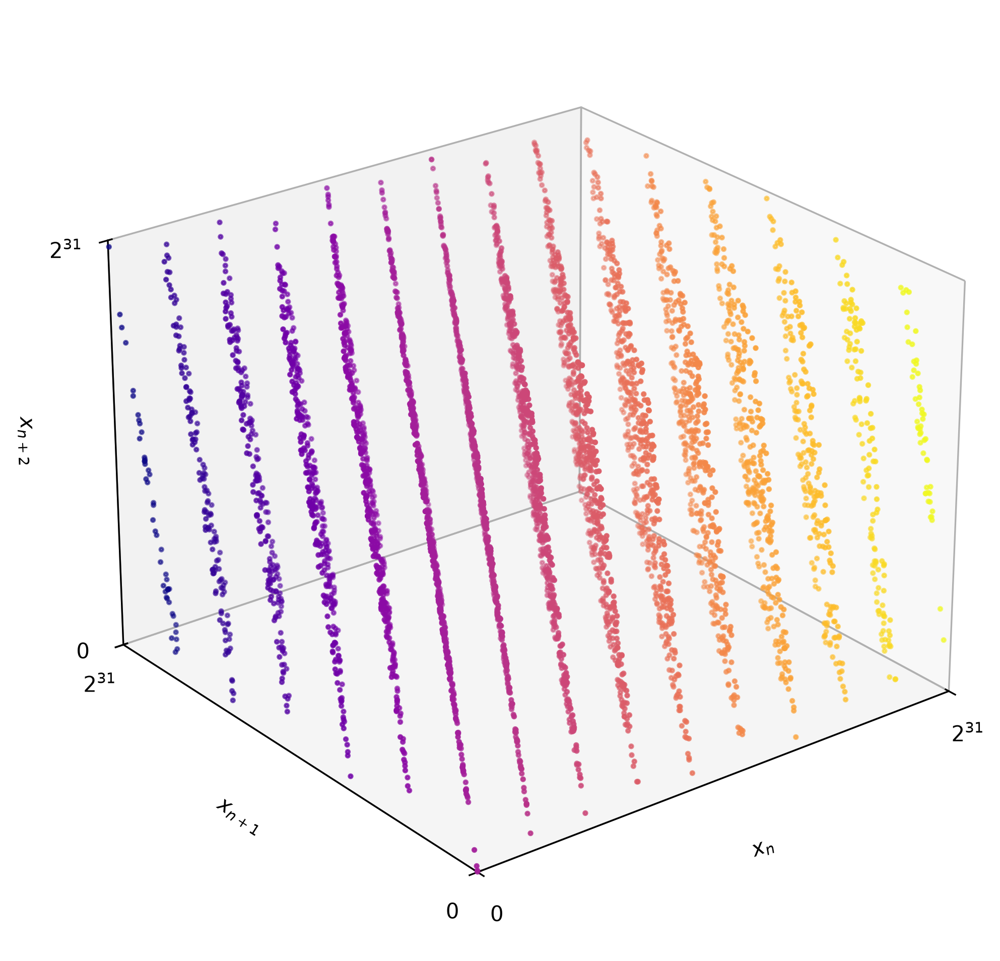

L'été passé, j'ai supervisé un stage d'initiation à la recherche sur le thème des *générateurs pseudo-aléatoires*, une famille d'algorithmes dont l'objectif est de générer des suites de nombres *les plus aléatoires possible*. Au cours de l'été, nous nous sommes penchés sur l'amélioration statistique des générateurs congruentiels par des opérateurs de mélange apériodique, d'après [des travaux de Balkova et al.](doi.org/10.1016/j.tcs.2016.07.042) suivant [une idée de Guimond et al.](doi.org/10.1023/a:1017533304855)
Ce billet résume quelques notes sur la théorie des générateurs congruentiels, incluant un joli théorème de Marsaglia qui révèle une faiblesse importante de ces générateurs.

## La théorie des générateurs congruentiels linéaires

Parmi les générateurs pseudo-aléatoires, la famille des *générateurs congruentiels linéaires* est particulièrement populaire à cause de leur simplicité, qui en fait un excellent cas d'étude, et de leur faible coût computationnel.
Ils obtiennent cependant d'assez mauvais résultats pour plusieurs tests statistiques.

Les générateurs congruentiels sont définis par la formule
$$
    x_{n+1} = (ax_n+c) \bmod m,
$$
où $a$ (le multiplicateur), $c$ (l'incrément) et $m$ (le module) sont des constantes.
Le choix de ces constantes, appelées *chiffres magiques*, détermine à la fois la performance et la qualité statistique.
Les générateurs congruentiels linéaires ont une complexité constante, mais en pratique la performance varie significativement selon le choix des chiffres magiques.
La meilleure performance est obtenue en choisissant $c=0$ et $m = 2^k$, typiquement avec $k = 32$, $64$ ou $128$ afin de tirer avantage de l'architecture de l'ordinateur.

Comme n'importe quel générateur dont les valeurs ne dépendent que d'un nombre borné de valeurs précédentes, les générateurs congruentiels sont ultimement périodiques: il existe $i\geq 0,p>0$ tels que $x_{n} = x_{n+p}$ pour tous $n\geq i$ 
(une conséquence du fait que tout élément d'un semigroupe fini admet une puissance idempotente).
Une période trop courte trahit la nature déterministe du générateur, se qui se traduit par une mauvaise performance statistique.
Une longue période est donc souhaitable, bien que non suffisante pour garantir la qualité statistique du générateur; les chiffres magiques $a=1, c=0$, par exemple, donnent une période maximale, mais une qualité statistique minimale.

Pour les générateurs congruentiels d'incrément $c\neq 0$, le théorème de Hull–Dobbell caractérise précisément les chiffres magiques garantissent une période maximale (de longueur $m$).

---
**Théorème** (Hull–Dobbell). Le générateur congruentiel linéaire déterminé par les chiffres magiques $a,c,m$ a une période de longueur $m$ si et seulement si toutes les conditions suivantes sont satisfaites:
1. $m$ et $c$ sont relativement premiers
2. $a-1$ est divisible par tous les facteurs premiers de $m$.
3. $a-1$ est divisible par 4 si $m$ l'est aussi.  
---

La situation est différente pour les générateurs d'incrément $c=0$, appelés *générateurs congruentiels multiplicatifs*.
Dans ce cas, la période est l'entier minimal $\lambda\geq 1$ tel que $a^\lambda \equiv 1 \bmod m$, appelé l'*ordre* de $a$ modulo $m$.
L'ordre des éléments est bornée par l'[indicatrice d'Euler](https://fr.wikipedia.org/wiki/Indicatrice_d%27Euler) $\varphi$; en fait, la formule $a^{\varphi(m)} \equiv 1 \bmod m$ (le [théorème d'Euler](https://fr.wikipedia.org/wiki/Th%C3%A9or%C3%A8me_d%27Euler_(arithm%C3%A9tique))) entraîne que l'ordre de tout élément est un diviseur de $\varphi(m)$.
Les multiplicateurs d'ordre maximal sont appelés les *éléments primitifs* modulo $m$. 

Un générateur congruentiel multiplicatif de période maximal est donc obtenu en choisissant une valeur de $a$ primitive modulo $m$.
Si le module est une puissance d'un nombre premier $p$, disons $m=p^k$, alors l'ordre $\lambda(p^k)$ des éléments primitifs est donné par la formule suivante, qui remonte aux *Disquisitiones arithmeticae* de Gauss:
$$
    \lambda(p^k) =
    \begin{cases}
        2^{k-1} & p=2,\ k\leq 2; \\\\
        2^{k-2} & p=2,\ k\geq 3; \\\\
        p^{k-1}(p-1) & p>2.
    \end{cases}
$$
Dans le cas où $m=2^k$, $k\geq 3$, un générateur congruentiel multiplicatif de période maximale a donc deux orbites distinctes.
Par exemple, un générateur congruentiel linéaire de module $m=2^{64}$ a une période maximale de $m/4 = 2^{62}$, et les éléments primitifs sont les entiers qui satisfont $a\equiv 3$ ou $5\bmod 8$.
Si $a\equiv 3\bmod 8$, les deux orbites maximales du générateurs sont 
$$ 
\lbrace x \mid x \equiv 1 \text{ ou } 3 \bmod 8 \rbrace,\ 
\lbrace x \mid x \equiv 5 \text{ ou } 7 \bmod 8 \rbrace,
$$ 
alors que si $a\equiv 5\bmod 8$, les orbites maximales sont 
$$
\lbrace x \mid x \equiv 1 \text{ ou } 5 \bmod 8 \rbrace,\ 
\lbrace x \mid x \equiv 3 \text{ ou } 7 \bmod 8 \rbrace.
$$
Dans chaque cas les orbites maximales forment une partition des entiers impairs $0\leq x < 2^{64}$ (les valeurs paires ont des orbites plus petites).

Regardons plus en détail le générateur défini par les chiffres magiques 
$$
a=14\,627\,392\,582\,107\,131\,917,\ m = 2^{64},
$$ 
tiré d'[un article de Steele et Vigna](https://doi.org/10.1002/spe.3030).
Si on prend la valeur initiale $x_0=1$, les 9 valeurs suivantes du générateur, en hexadécimal, sont:
```
cafef00ddeadf00d
5f40e3d6deaa60a9
44249433e97a5895
f0714195a0f32f91
3bbc9d710bee5a5d
64038315c6aac6b9
2d98f37ce9fe8765
1c6fe342961c9021
1a396f136adf41ad
```
On peut remarquer que le chiffre le moins significatif (celui à droite) des représentations hexadécimales semble avoir une période de longueur 8, beaucoup plus petite que la période du générateur, de longueur $2^{32}$. 
Cette observation révèle une faiblesse importante des générateurs congruentiels de module $2^k$. 
Si on exprime les valeurs en format binaire, on peut voir cette faiblesse encore plus clairement;
par exemple, voici les 4 bits moins significatifs (c'est-à-dire les bits droite) des 9 valeurs ci-dessus:
```
1001
0101
0001
1101
1001
0101
0001
1101
1001
```
Les 2 bits les moins significatifs sont constants, une conséquence du fait que l'élément primitif $a$ est congru à 5 modulo 8, donc à 1 modulo 4; un élément primitif congru à 3 modulo 8 fait mieux, mais à peine, avec une période de longueur 2 pour les les 2 bits de droite.

Les périodes courtes des bits les moins significatifs provient du fait que les $n$ bits de droite représente les valeurs d'un générateur multiplicatif de module $2^{n}$, ce qui fondamentalement s'explique par le fait que la projection canonique $\mathbb{Z}\to\mathbb{Z}/2^{n}\mathbb{Z}$ se factorise par $\mathbb{Z}\to\mathbb{Z}/2^{m}\mathbb{Z}$. 
Une méthode courante pour palier à cette faiblesse est de n'utiliser que les $k/2$ bits les plus significatifs des valeurs d'un générateurs multiplicatifs de module $2^k$.
Bien sûr cela réduit de moitié l'efficacité du générateur, mesurée en bits par seconde.

## RANDU et le théorème de Marsaglia

Si la mauvaise qualité des bits les moins significatifs est une faiblesse caractéristique des générateurs de modules $2^k$, il existe un défaut fondamental qui touche tous les générateurs congruentiels linéaires, peu importe le module. 
Ce défaut a été exposé notamment par Marsaglia dans un article intitulé [*Random Numbers Fall Mainly in the Planes*](https://doi.org/10.1073/pnas.61.1.25).
Je cite ici un passage de son article (traduction libre):
> [...] tous les générateurs congruentiels multiplicatifs ont un défaut — un défaut qui les rend impropres à plusieurs problèmes de Monte Carlo, et qui ne peut être corrigé en ajustant la valeur initiale, le multiplicateur ou le module. 

Ce défaut (Marsaglia parle de la *nature crystalline* des générateurs multiplicatifs) est observé dans le *réseau* de $\mathbb{R}^d$ défini par les valeurs $x_n$ du générateur,
$$
    \Lambda_d = \lbrace (x_n,x_{n+1}\dots,x_{n+d-1}) \in\mathbb{R}^d \mid n\in\mathbb{N} \rbrace.
$$
Marsaglia montre que chez les générateurs congruentiels, $\Lambda_d$ peut être couvert par un petit nombre d'hyperplans parallèles: en dimension $d$ et pour un module $m$, il en faut moins de
$$
    (d!m)^{1/d}.
$$
À titre d'exemple, $(6\cdot 2^{32})^{1/3} \approx 2954$; donc pour $m=2^{32}$, le réseau $\Lambda_3$ peut être couvert par moins de $2954$ hyperplans parallèles.
Pour le réseau $\Lambda_6$, ce nombre descend à $(720\cdot 2^{32})^{1/6} \approx 121$. 
En pratique, le nombre d'hyperplans parallèles nécessaire peut être beaucoup plus petit que cette borne.

L'idée derrière la preuve du théorème de Marsaglia est simple. 
Trouver un recouvrement de $\Lambda_d$ par des hyperplans parallèles revient à trouver une solution de la congruence
$$
c_1 + c_2a + \dots + c_d a^{d-1} \equiv 0 \mod m,
$$
avec les $c_i$ entiers; en d'autres mots, on cherche un vecteur orthogonal à $(1,a,\dots,a^{d-1})$ dans $(\mathbb{Z}/m\mathbb{Z})^d$. 
Ainsi tous les vecteurs de $\Lambda_d$ sont contenus dans des hyperplans normaux à $\vec c = (c_1,\dots, c_d)$,
$$
    H = \lbrace \vec v\in\mathbb{R}^d \mid \langle \vec c, \vec v\rangle = km \rbrace,
$$
où $k$ est un certain entier. 
Le fait que les valeurs du générateur sont dans l'intervalle $[0,m-1]$ implique les inégalités
$$
    -m\sum_{c_i<0}c_i < \sum c_ix_{n+i-1} < m\sum_{d_i>0}c_i,
$$
qui délimitent un intervalle contenant $(\sum |c_i|) -1$ multiples de $m$, où $\sum |c_i| = \Vert \vec c\Vert_1$ est tout simplement la *norme 1* du vecteur normal $\vec c$. 
La preuve du théorème est donc réduite à l'existence d'un vecteur normal $\vec c$ qui satisfait l'inégalité
$$
    \Vert\vec c\Vert_1 \leq (d!m)^{1/d}.
$$
Marsaglia montre que ces solutions correspondent aux points à coordonnées entières à l'intérieur d'une certaine région convexe de $\mathbb{R}^d$, et remarque que l'existence de ces points est garanti par un [théorème de Minkowski](https://fr.wikipedia.org/wiki/Th%C3%A9or%C3%A8me_de_Minkowski).

Un cas d'étude célèbre où la nature crystalline du générateur est particulièrement frappante est le générateur RANDU, introduit par IBM dans les années 60 et fréquemment cité en ligne comme un exemple de générateur à éviter.
Il s'agit du générateur multiplicatif de chiffres magiques $a=65\,539$ et $m = 2^{31}$.
Le multiplicateur satisfait la relation $a = 2^{16}+3$, ce qui entraîne $a^2 \equiv 6a - 9\bmod m$.
Le réseau $\Lambda_3$ est donc couvert par seulement 15 hyperplans parallèles,
$$
    \lbrace (x,y,z)\in\mathbb{R}^3 \mid 9x-6y+z = k\cdot 2^{31} \rbrace,\  -5\leq k\leq 9,   
$$
nettement moins que la borne de 2343 du théorème de Marsaglia.
Il est intéressant de noter que la relation qui est à l'origine de la mauvaise qualité du générateur ($a = 2^{16}+3$) permet en même temps d'optimiser sa performance, et c'est précisément ce qui aurait poussé IBM à l'utiliser.

La structure crystalline de RANDU est visible à l'oeil nu; la figure ci-dessous montre 5000 points du réseau $\Lambda_3$, et on peut facilement y compter à la main les 15 hyperplans couvrant $\Lambda_3$.
<figure align="center">
  
  <figcaption>
    Le code pour générer la figure peut être téléchargé <a href="/assets/blog/2026/randu_plot.py" download>ici</a>.
  </figcaption>
</figure>

Le calcul ci-dessus suggère un algorithme simple pour calculer une famille recouvrantes d'hyperplans; il suffit d'effectuer une suite de divisions euclidiennes modifiées
$$ 
\begin{aligned}
    b_{d-1} &= q_{d-2}b_{d-2} + r_{d-2}, &-\tfrac{b_{d-2}}2\leq r_{d-2} <\tfrac{b_{d-2}}2,\\\\
    r_{d-2} &= q_{d-3}b_{d-3} + r_{d-3}, &-\tfrac{b_{d-3}}2\leq r_{d-3} <\tfrac{b_{d-3}}2,\\\\
    &\vdots \\\\
    r_{2} &= q_{1}b_{1} + r_{1}, &-\tfrac{b_{1}}2\leq r_{1} <\tfrac{b_{1}}2,
\end{aligned}
$$
où $b_i$ est le représentant de la classe de $a^i$ mod $m$ dans $[0,m-1]$. 
En substituant chaque équation dans la précédente de bas en haut, on obtient
$$
    a^{d-1} \equiv q_{d-2}a^{d-2} + \dots + q_1a + r_1 \mod m,
$$
ce qui permet de conclure que le réseau $\Lambda_d$ est couvert par $\sum |q_i| + |r_1|$ hyperplans.

Cette méthode élémentaire permet d'obtenir un résultat raisonnable pour RANDU en dimension $d=4,5,6$:

- en dimension 4: $x_4 - 4x_3 - 3x_2 + 18x_1 =\pm k\cdot 2^{31}$, $-7 < k < 19$, une famille de 25 hyperplans contre 2344 pour la borne de Marsaglia;
- en dimension 5: $x_5 -4x_4 + 27x_1 = \pm k\cdot 2^{31}$, $-4<k<28$, une famille de 31 hyperplans contre 191 pour la borne de Marsaglia ;
- en dimension 6: $x_6 -4x_5 + x_4 + 54x_1 = \pm k\cdot 2^{31}$, $-4<k<56$, une famille de 59 hyperplans contre 107 pour la borne de Marsaglia.

Pour les dimensions plus grandes, le nombre d'hyperplans obtenu avec cette méthode dépasse la borne de Marsaglia: en dimension 7 elle donne une famille de 143 hyperplans, contre 72 pour la borne de Marsaglia. 
Pour trouver un vecteur normal qui minimise le nombre d'hyperplans, il faut faire appel à des techniques plus sophistiquées; à ce sujet, voir [l'article de L'Écuyer et Couture](https://doi.org/10.1287/ijoc.9.2.206).